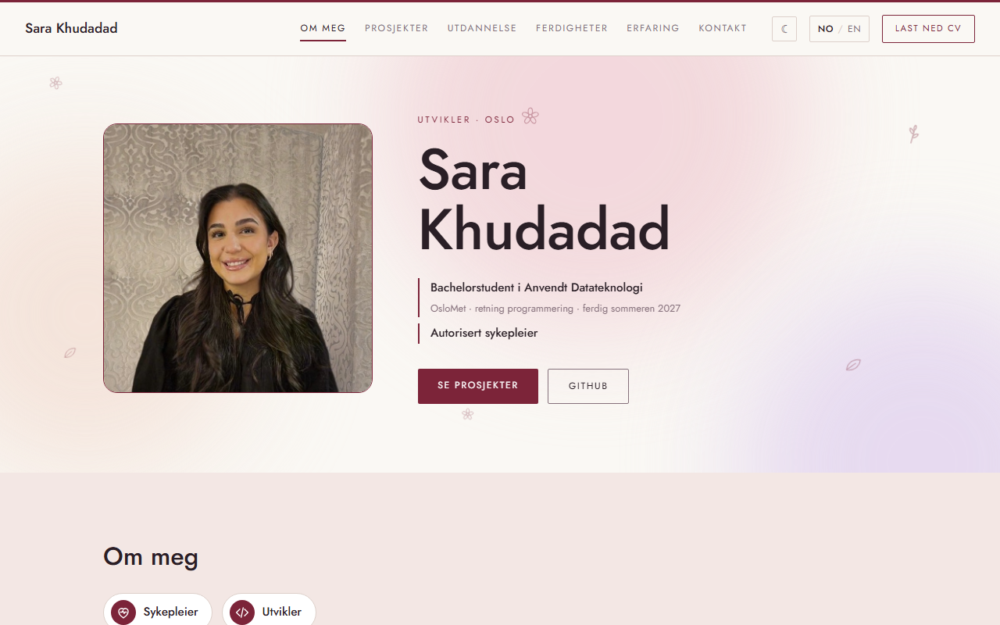

# Portefølje

Personlig porteføljeside for Sara Khudadad. Siden viser bakgrunn, prosjekter,
utdanning, ferdigheter, erfaring og kontaktinformasjon.

Nettside: https://sarak.dev



## Innhold

- Norsk og engelsk, med språkvalg i menyen
- Lyst og mørkt tema
- Tilpasset mobil, nettbrett og PC
- Prosjektkort som åpnes for å vise beskrivelse, lenker og demovideo
- CV på norsk og engelsk som kan lastes ned
- Teksten bygges inn i HTML-en, slik at søkemotorer kan lese den

## Teknologi

- React 19
- Vite
- CSS
- oxlint
- GitHub Actions og GitHub Pages

## Mapper

```
src/
  components/   Én komponent per seksjon
  hooks/        Meny, prosjektkort og tema
  i18n/         All tekst på norsk og engelsk
cv/             Kilden til CV-en
public/         Bilder, video og CV som PDF
scripts/        Bygger ferdig HTML av siden
```

## Kjøre lokalt

```bash
npm install
npm run dev
```

Bygge siden:

```bash
npm run build
```

## Publisering

Siden publiseres automatisk til GitHub Pages ved hver push til `main`.
